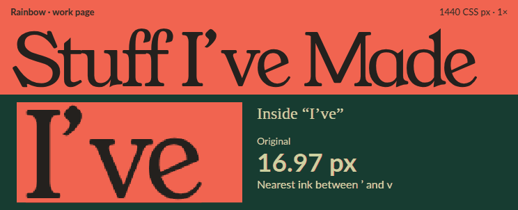
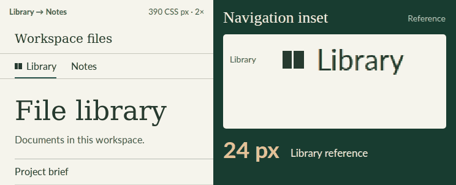
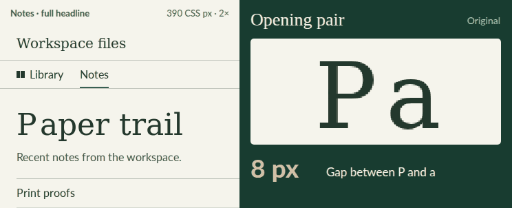

# Eagle Eye

Eagle Eye is a Codex skill for spotting design details that feel off. It uses screenshots and visual guides to check alignment, spacing, layout shifts between views, and headline kerning.

## Install in Codex

Paste this prompt into Codex on each computer where you want to use Eagle Eye.

```text
Use $skill-installer to install https://github.com/rustyameadows/eagle-eye/tree/main/skills/eagle-eye
```

On your next turn, attach a screenshot or point Codex at a local page and try one of these prompts.

- `Use $eagle-eye on this screenshot. What looks off? Show me the strongest finding.`
- `Use $eagle-eye to evaluate this headline. Show the whole line and the spacing between letters.`
- `Use $eagle-eye to compare these two views. Show me which shared elements move.`

## Watch an audit

### Rainbow’s “Stuff I’ve Made” headline

At desktop size, the apostrophe and v in “I’ve” sat 16.97 px apart. Loosening the whole headline opened that gap to 20.00 px, nearly a word space. The shipped pair adjustment brought it back to 9.22 px. Watch the whole line first, then follow the two marked ink pixels in the enlargement.

<picture>
  <source media="(prefers-reduced-motion: reduce)" srcset="example/walkthroughs/rainbow-comparison.png">
  <source media="(max-width: 600px)" srcset="example/walkthroughs/rainbow-compact.gif">
  
</picture>

[Download the four-width Rainbow proof](https://raw.githubusercontent.com/rustyameadows/eagle-eye/main/example/walkthroughs/rainbow-proof.zip) · [See the before and after](example/walkthroughs/rainbow-comparison.png) · [Original audit plate and source PNGs](example/walkthroughs/rainbow/README.md)

### Does the navigation move between pages?

Follow **Library → Notes**. The heading keeps its 24 px content inset, but the same book icon shifts from x=24 to x=27. Both detail crops share one viewport origin. After the repair, the icon meets the same guide on both pages.

<picture>
  <source media="(prefers-reduced-motion: reduce)" srcset="example/walkthroughs/navigation-comparison.png">
  <source media="(max-width: 600px)" srcset="example/walkthroughs/navigation-compact.gif">
  
</picture>

[Compare the navigation stills](example/walkthroughs/navigation-comparison.png)

### Does one pair break the word?

Read **Paper trail** at its original size, then inspect the P and a. A margin on the initial P makes the opening look split. Removing it restores native kerning and narrows the gap between the letters’ outer ink columns from 8 px to 2 px. The other pairs keep their spacing.

<picture>
  <source media="(prefers-reduced-motion: reduce)" srcset="example/walkthroughs/kerning-comparison.png">
  <source media="(max-width: 600px)" srcset="example/walkthroughs/kerning-compact.gif">
  
</picture>

[Compare the headline stills](example/walkthroughs/kerning-comparison.png) · [Reproduce the workspace captures](example/walkthroughs/REHEARSAL.md)

### Two details on one screen

The original *Workspace files* demo follows a folder icon and a file list through two repairs. Each retest uses the same guide as the original capture.

**Is the folder centered in its tab?** The top and bottom edges of the 28 px tab define its midpoint. The folder sits 3 px low. After the repair, its center lands on the guide.

<picture>
  <source media="(prefers-reduced-motion: reduce)" srcset="example/walkthroughs/folder-comparison.png">
  <source media="(max-width: 600px)" srcset="example/walkthroughs/folder-compact.gif">
  
</picture>

[Compare the two folder captures side by side](example/walkthroughs/folder-comparison.png)

**Do the files look like peers?** The first and last markers establish a shared left edge. The middle file starts 6 px farther right, making it look nested. The retest shows all three markers on the same line.

<picture>
  <source media="(prefers-reduced-motion: reduce)" srcset="example/walkthroughs/rows-comparison.png">
  <source media="(max-width: 600px)" srcset="example/walkthroughs/rows-compact.gif">
  
</picture>

[Compare the list captures side by side](example/walkthroughs/rows-comparison.png) · [Read the audit and inspect the original screenshots](example/AUDIT.md)

## Local capture tools

You can start with a screenshot. To have Eagle Eye take its own browser captures and generate pixel proofs, it uses Node.js with Playwright and Chromium, plus Python 3 with Pillow. Ask Codex to set up those tools on the new machine. For manual setup on macOS or Linux, clone this repo and run these commands from its root with Node.js, npm and Python 3 installed.

```sh
npm install --no-save --package-lock=false playwright
npx playwright install chromium
python3 -m venv .venv
. .venv/bin/activate
python3 -m pip install Pillow
```

Run the capture tools from that checkout with the Python environment active.

## Examples

See a [single-screen audit with before-and-after images](example/AUDIT.md), the [24-screen layout benchmark](example/view-audit/README.md), or the [headline typography benchmark](example/headline-audit/README.md). To explore the interactive HTML reports, open them locally from a clone of the repository.
