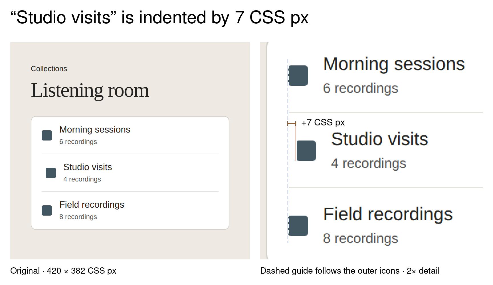
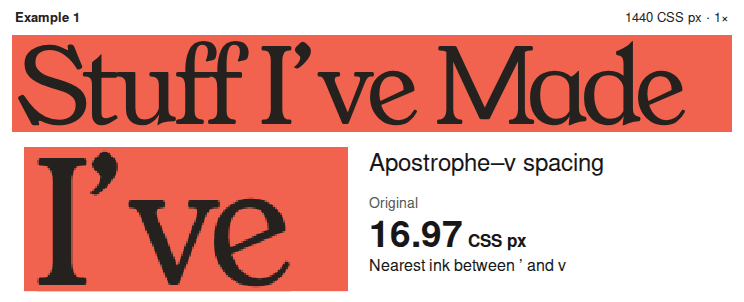
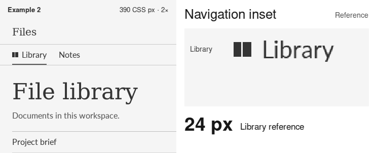
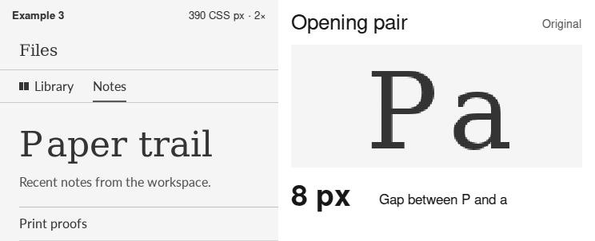
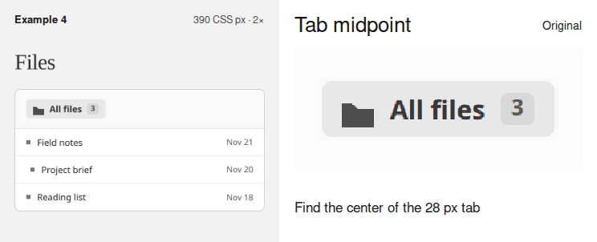
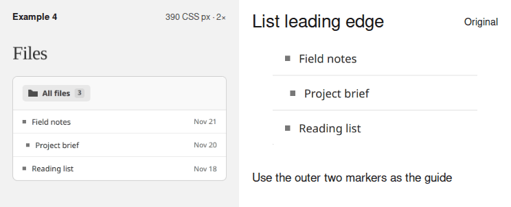

# Eagle Eye

Eagle Eye is a Codex skill for spotting design details that feel off. It uses screenshots and visual guides to check alignment, spacing, layout shifts between views, and headline kerning.

## Install in Codex

Paste this prompt into Codex on each computer where you want to use Eagle Eye.

```text
Use $skill-installer to install https://github.com/rustyameadows/eagle-eye/tree/main/skills/eagle-eye
```

On your next turn, attach a screenshot or point Codex at a local page and try one of these prompts.

- `Use $eagle-eye on this screenshot. What looks off? Show me the strongest finding.`
- `Use $eagle-eye to evaluate this headline. Show the whole line and the spacing between letters.`
- `Use $eagle-eye to compare these two views. Show me which shared elements move.`

## Proof style

A dashed indigo line marks the intended edge. A solid coral line marks the observed edge. A capped ochre bracket measures the distance. Helvetica labels stay black or white so the color belongs to the measurement.



A blind reviewer produced this figure from one screenshot and the installed skill. [Style guide and palette](skills/eagle-eye/references/proof-style.md) · [Original screenshot and trial record](example/proof-style/TRIAL.md)

## Audit results

### Example 1

**Headline spacing.** At 1440 px, the gap between the apostrophe and v in “I’ve” measured 16.97 px. Adjusting tracking across the headline opened it to 20.00 px. A local pair adjustment reduced it to 9.22 px.

<picture>
  <source media="(prefers-reduced-motion: reduce)" srcset="example/walkthroughs/example-1-comparison.png">
  <source media="(max-width: 600px)" srcset="example/walkthroughs/example-1-compact.gif">
  
</picture>

[Before and after](example/walkthroughs/example-1-comparison.png) · [Square GIF](example/walkthroughs/example-1-square.gif) · [Captures and measurements](example/walkthroughs/example-1/README.md) · [Download the four-width proof](https://raw.githubusercontent.com/rustyameadows/eagle-eye/main/example/walkthroughs/example-1.zip)

### Example 2

**Page-to-page alignment.** The navigation icon moved 3 px to the right on the second page while the heading stayed at x = 24 px. After the inset correction, the icon starts at x = 24 px on both pages.

<picture>
  <source media="(prefers-reduced-motion: reduce)" srcset="example/walkthroughs/example-2-comparison.png">
  <source media="(max-width: 600px)" srcset="example/walkthroughs/example-2-compact.gif">
  
</picture>

[Before and after](example/walkthroughs/example-2-comparison.png) · [Square GIF](example/walkthroughs/example-2-square.gif)

### Example 3

**Opening pair.** The gap between the ink columns of P and a in “Paper trail” measured 8 px. Removing a margin on the P restored native kerning and reduced the gap to 2 px. The remaining pairs kept their spacing.

<picture>
  <source media="(prefers-reduced-motion: reduce)" srcset="example/walkthroughs/example-3-comparison.png">
  <source media="(max-width: 600px)" srcset="example/walkthroughs/example-3-compact.gif">
  
</picture>

[Before and after](example/walkthroughs/example-3-comparison.png) · [Square GIF](example/walkthroughs/example-3-square.gif)

### Example 4

**Tab alignment.** The folder icon sat 3 px below the midpoint of a 28 px tab. The retest measures 0 px against the same guide.

<picture>
  <source media="(prefers-reduced-motion: reduce)" srcset="example/walkthroughs/example-4-tab-comparison.png">
  <source media="(max-width: 600px)" srcset="example/walkthroughs/example-4-tab-compact.gif">
  
</picture>

**List alignment.** The middle row started 6 px farther right than its siblings. The retest places all three markers on the same vertical guide.

<picture>
  <source media="(prefers-reduced-motion: reduce)" srcset="example/walkthroughs/example-4-list-comparison.png">
  <source media="(max-width: 600px)" srcset="example/walkthroughs/example-4-list-compact.gif">
  
</picture>

[Tab comparison](example/walkthroughs/example-4-tab-comparison.png) · [List comparison](example/walkthroughs/example-4-list-comparison.png) · [Square tab GIF](example/walkthroughs/example-4-tab-square.gif) · [Square list GIF](example/walkthroughs/example-4-list-square.gif) · [Audit record](example/AUDIT.md)

## Local capture tools

You can start with a screenshot. To have Eagle Eye take its own browser captures and generate pixel proofs, it uses Node.js with Playwright and Chromium, plus Python 3 with Pillow. Ask Codex to set up those tools on the new machine. For manual setup on macOS or Linux, clone this repo and run these commands from its root with Node.js, npm and Python 3 installed.

```sh
npm install --no-save --package-lock=false playwright
npx playwright install chromium
python3 -m venv .venv
. .venv/bin/activate
python3 -m pip install Pillow
```

Run the capture tools from that checkout with the Python environment active.

## Evaluation fixtures

See a [single-screen audit with before-and-after images](example/AUDIT.md), the [24-screen layout benchmark](example/view-audit/README.md), or the [headline typography benchmark](example/headline-audit/README.md). To explore the interactive HTML reports, open them locally from a clone of the repository.
