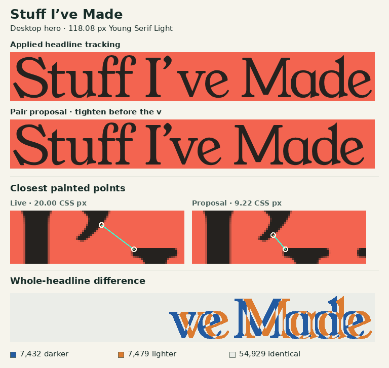

# Rainbow’s work-page headline

“Stuff I’ve Made” uses Young Serif Light. In the original headline the two f’s crowd together, yet the apostrophe and v already look far apart. Loosening the overall tracking gave the f’s room and made the gap in “I’ve” even larger. The shipped version keeps the looser tracking and draws “ve” back toward the apostrophe.

[Original site revision](https://github.com/rustyameadows/personal-site-rainbow/commit/ea01536b6e695ec0c5c7b8ec8edc3e9c6bb211d4) · [Shipped change](https://github.com/rustyameadows/personal-site-rainbow/commit/f1c07dccf575cb2f3ce57bca30b4c0ce708a3cb0)

## The original review

This plate compares tracking alone with the proposed pair adjustment. The proposal shown here subsequently shipped. The bottom overlay shows exactly which headline pixels became darker or lighter when “ve” moved. [Six pair-spacing trials](pair-trials.png)



## Inspect the originals

Open `pixels/index.html` locally. Choose a viewport, compare the three full lines at their captured CSS size, then switch to the difference view or inspect an individual pixel. Keep the folder together to use the viewer’s original PNG download links.

| Viewport | Original | Tracking only | Shipped |
| --- | --- | --- | --- |
| 1440 px · 1× | [16.97 px](pixels/rasters/desktop/stage-1.png) | [20.00 px](pixels/rasters/desktop/stage-2.png) | [9.22 px](pixels/rasters/desktop/stage-3.png) |
| 820 px · 1× | [10.63 px](pixels/rasters/tablet/stage-1.png) | [12.04 px](pixels/rasters/tablet/stage-2.png) | [5.66 px](pixels/rasters/tablet/stage-3.png) |
| 390 px · 2× | [7.43 px](pixels/rasters/phone/stage-1.png) | [8.14 px](pixels/rasters/phone/stage-2.png) | [3.91 px](pixels/rasters/phone/stage-3.png) |
| 320 px · 2× | [6.02 px](pixels/rasters/narrow/stage-1.png) | [6.73 px](pixels/rasters/narrow/stage-2.png) | [3.20 px](pixels/rasters/narrow/stage-3.png) |

The values are the shortest distances in CSS pixels between painted pixel centers of ’ and v at 50% ink coverage. The white segment in the animation connects those two recorded points. The tracking-only desktop gap of 20.00 px was almost as wide as the 20.10 px first word space. The local −0.125em adjustment kept “I’ve” together at reading size. The four source retests matched the accepted pair trial in all 186,505 pixels of the headline crops. The copy, accessible name and single-line wrapping held at all four widths. [Pair coordinates](pair.json) · [Source retest hashes](source-retest.json)

From an Eagle Eye checkout, rebuild the offline viewer and difference maps in a fresh directory with the original PNGs in this folder.

```sh
python3 skills/eagle-eye/scripts/pixel-proof.py example/walkthroughs/rainbow/manifest.json /tmp/rainbow-pixel-proof
```
